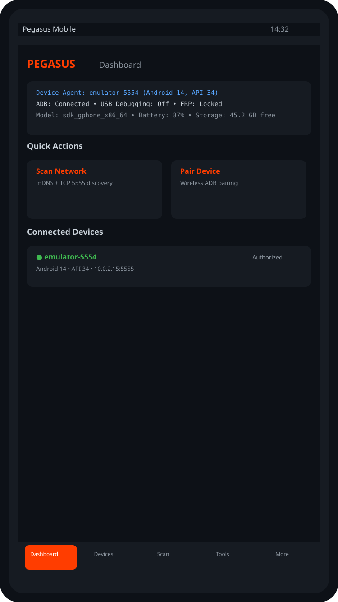
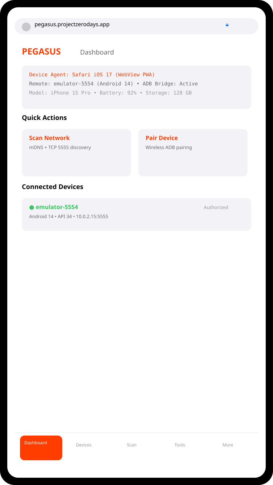
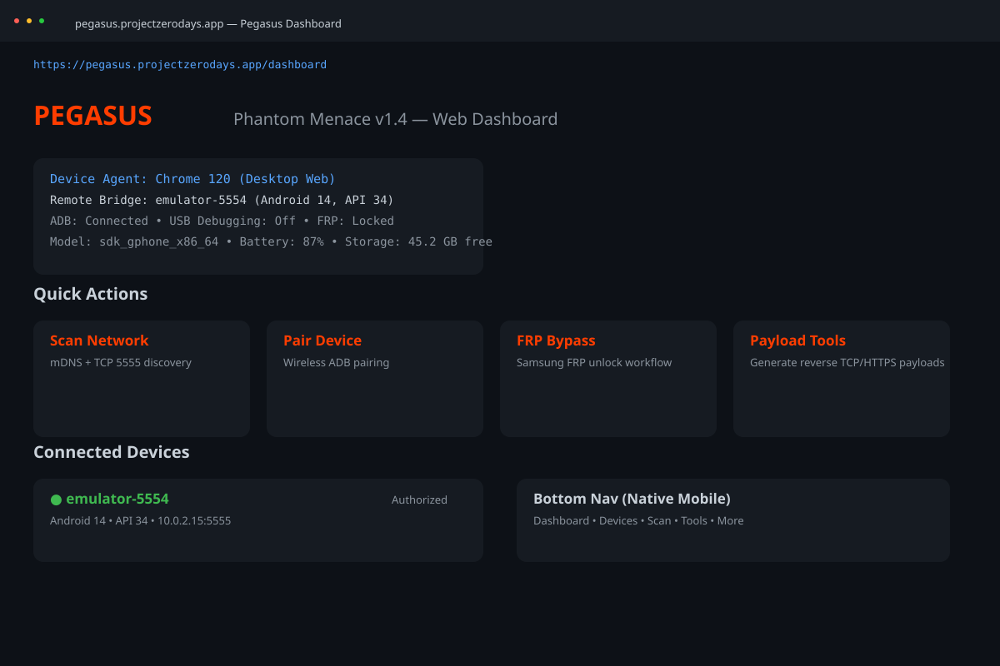
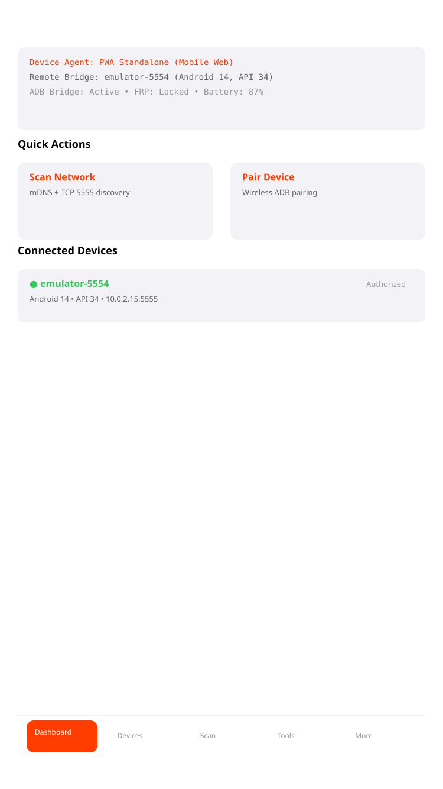

<div align="center">


# Pegasus: Phantom Menace

**Android Device Management & Security Audit Tool — v1.4**

**License:** MIT

</div>

---

## ✅ Current State (v1.4)

- **Executable (EXE):** `dist/Pegasus-v1.4.exe` (Windows native, icon embedded via PyInstaller, version info embedded)
- **Mobile (APK):** `pegasus-mobile/` — native Kotlin Android companion with embedded WebView loading the Pegasus dashboard, native bottom nav menu (Dashboard, Devices, Scan, Tools, More); build via `./gradlew assembleDebug`
- **Icons / Media assets:** Organized in `assets/icons/` (Windows `.ico`, Android `mipmap-*`, macOS `.icns`, Web favicons, iOS sizes, source PNG)
- **Source:** `pegasus_v_1.4.py` (rebuilt BLOB payload), `payload_src_1.3.py` (editable source), `pegasus_net.py` (options 24/25)
- **Screenshots:** `assets/screenshots/screenshot_android_mobile.svg`, `screenshot_ios_pwa.svg`, `screenshot_web_desktop.svg`, `screenshot_pwa_mobile.svg`

---

## ✨ Features

| Option | Feature | Description |
|--------|---------|-------------|
| 24 | **Scan Network for ADB** | mDNS + TCP 5555 scan; discovers wireless endpoints |
| 25 | **Pair & Connect** | Android 11+ wireless pairing with one-time code |
| 26 | **Extra Features (High-Value)** | 17 sub-features: AI Assistant, Report Generator, CVE Scanner, Live Dashboard, Telegram, Campaign Manager, Steganography, Mass Payload, DNA Tracker, AI Mutator, QR Delivery, SSL Bypass, Listener Monitor, ngrok, Network Forwarding, Network Scanner, and more |

---

## 📸 Screenshots

### Android — Native Kotlin Mobile App (WebView + Bottom Nav)


### iOS — PWA in Safari (iOS-style Bottom Tab Bar)


### Web — Desktop Browser Dashboard


### PWA — Standalone Mobile Web View


---

## 🖥️ Executable Assets

| Platform | Asset Path | Icon Wired? |
|----------|-----------|-------------|
| Windows EXE | `dist/Pegasus-v1.4.exe` | ✅ `pegasus_icon.ico` embedded via PyInstaller `--icon` |
| Android APK | `pegasus-mobile/app/src/main/res/mipmap-*/ic_launcher.png` | ✅ Manifest `@mipmap/ic_launcher`; using 48/72/144/192/512 sizes |
| macOS (future) | `assets/icons/macos/pegasus.icns` | ✅ Source icon ready |
| Web / Favicon | `assets/icons/web/favicon-*.png` + `pegasus_icon.png` | ✅ Source logo ready |

---

## 📁 Organize / Use Icons

```
assets/icons/
  windows/pegasus_icon.ico         -> EXE icon (PyInstaller)
  web/pegasus_icon.png             -> README/logo source
  macos/pegasus.icns               -> macOS app bundle
  android/android_*.png            -> Source for mipmap build
  screenshots/screenshot_*.svg     -> README docs (Android, iOS, Web, PWA)
```

---

### 🚀 Extra Features (Option 26) — High-Value Capabilities

Integrated from DeadDroid v2.0 — 17 sub-features:

| Sub-Option | Feature | Description |
|-----------|---------|-------------|
| 1 | **AI Assistant (Claude)** | Real-time pentest guidance via Claude AI |
| 2 | **Report Generator (HTML)** | Professional pentest reports with findings |
| 3 | **Android CVE Scanner** | Vulnerability fingerprinting via ADB + NVD API |
| 4 | **Live Dashboard** | Real-time device monitoring TUI |
| 5 | **Telegram Remote Control** | Push alerts + remote command execution |
| 6 | **Campaign Manager** | Organize penetration test assessments |
| 7 | **Steganography Delivery** | Hide payload URLs in images (LSB) |
| 8 | **Mass Payload Generator** | Batch payload generation with DNA tags |
| 9 | **Payload DNA Tracker** | Unique payload tracking system |
| 10 | **AI Mutation Engine** | AV evasion suggestions via Claude |
| 11 | **QR Payload Delivery** | Generate QR codes for payload URLs |
| 12 | **SSL Pinning Bypass** | Frida script generator |
| 13 | **Listener Health Monitor** | Port polling with alerts |
| 14 | **ngrok Tunnel Manager** | TCP/HTTP tunnel management |
| 15 | **Network & Port Forwarding** | socat/SSH/iptables forwarding |
| 16 | **Network Scanner (nmap)** | Host discovery and port scanning |

---

## 🖥️ Web GUI (v2.0) — Mission Control

The `pegasus/` Python package ships a complete operator console: a React +
TypeScript front end (`pegasus/ui/web`) served by a Flask API, started with a
single command.

```bash
# build the front end once
cd pegasus/ui/web && npm install && npm run build && cd ../../..

# run it
python -m pegasus.ui.web.server --port 5000 --open
#   or:  pegasus serve
```

Download the prebuilt standalone launcher from the Releases page:
**`Pegasus-Web.exe`** (no Python required — bundles the API and the SPA).

### What the GUI covers

**32 pages**, every one wired to the live plugin system rather than mock data.

| Area | Pages |
|---|---|
| Command | Mission Control, Devices, Monitoring |
| Access & exploitation | Access Workflow, Workflow Engine, Zero-Click & CVE, Post-Exploitation, Capability Parity |
| Device data | Locations, Geofences, Call Logs, Contacts, Messages, Browser, Applications, Photos & Video, Wi-Fi, Keystrokes, Activity Timeline, Keywords |
| Operations | Payloads, Wordlists, Sessions, Campaigns, Reports |
| Network & tools | Network Scanner (nmap), Toolbox (binary console + slash commands), Skills Catalog |
| System | Plugins, Command Center, Settings |

### Highlights

- **Live job pipeline** — every action (ADB shell, nmap, msfvenom, lifecycle
  runs) is dispatched as a background job; output streams into a terminal view
  with progress and cancellation.
- **Real device telemetry** — contacts, SMS, call logs, Chrome history, installed
  apps, media, Wi-Fi and GPS are pulled over ADB and cached in a local SQLite
  store with geofences, keyword tracking and per-device notes.
- **Full command surface** — all 40 plugin commands and 46 slash commands are
  browsable and executable from the UI, with the same output you would see in
  the CLI.
- **Toolchain awareness** — ADB, fastboot, scrcpy, nmap, msfvenom, Frida,
  apktool, jadx, TShark, Wireshark, ngrok and OpenSSL are probed and shown with
  version and availability.
- **PWA-ready** — installable manifest, offline shell, responsive layout down to
  phone width.

Full details: [`pegasus/ui/web/README.md`](pegasus/ui/web/README.md).

### Test the GUI backend

```bash
python -m pytest pegasus/ui/web/tests -q      # 24 tests, no device required
cd pegasus/ui/web && npm run typecheck
```

---

## 🛠️ Build / Install

**CL:** `python3 pegasus_v_1.4.py`
**EXE (CLI):** `pyinstaller --onefile --name Pegasus-v1.4 --icon=pegasus_icon.ico pegasus_v_1.4.py`
**EXE (Web GUI):** `python -m PyInstaller Pegasus-Web.spec --noconfirm` → `dist/Pegasus-Web.exe`
**APK:** See `pegasus-mobile/README.md` and `build_apk.bat`

---

## 📜 License

MIT License — See `LICENSE` file.
