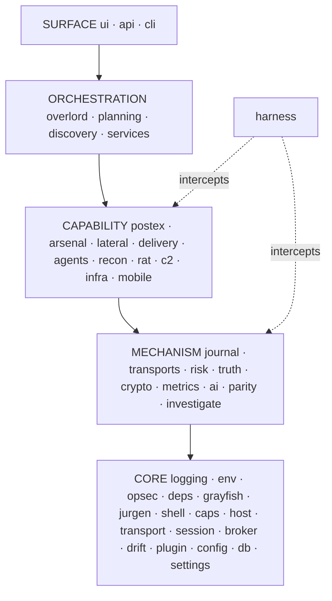
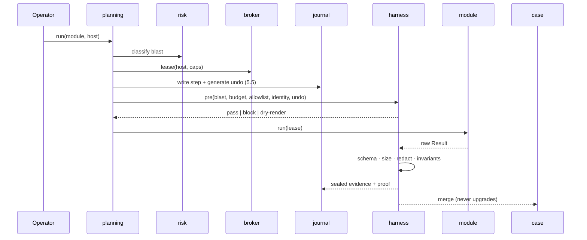
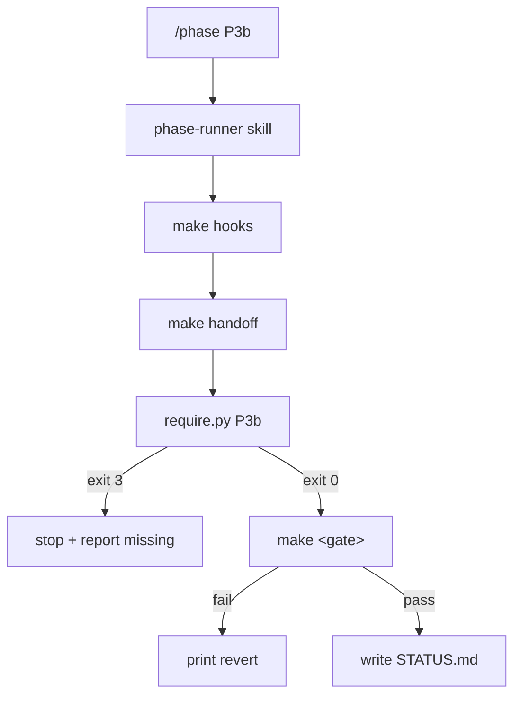
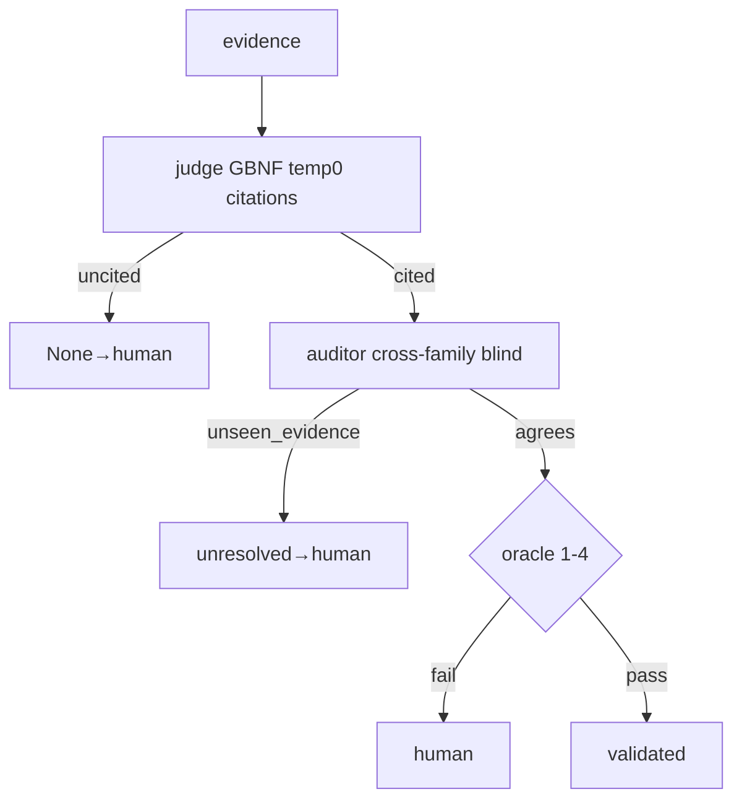

# Pegasus: Phantom Menace — Master Architecture Blueprint v28.0

**Document ID:** `docs/PLAN.md`
**Supersedes:** v19.0, v21.0, v21.1, v22.0, v23.0, v24.0, v25.0, v26.0, v27.0, and the uploaded "Pegagus plan.txt"
**Execution model:** phase-contract, machine-enforced (`build/phases.yaml` + `scripts/require.py` + `scripts/handoff.py` + versioned hooks via `core.hooksPath` + generated agent adapters)
**Target:** v3.0.0 structural, then v3.1.0 – v3.4.0 capability

---

## 0. Document control

| Field | Value |
|---|---|
| Status | Normative. Conflicts resolve to this document |
| Audience | Single operator plus autonomous coding agent |
| Binding rule | No phase begins until `scripts/require.py <phase>` exits 0 **and** the prior gate passes |
| Hard constraint | **v3.0.0 adds no capability** |
| Precedence | This document > `build/phases.yaml` > `skills/agents.yaml` > `docs/STATUS.md` > code comments > README |
| Handoff | `docs/HANDOFF.md` is **generated** from §60. Regeneration is automatic via versioned hooks; drift fails G13, G14 and blocks push |
| Agent layer | `.opencode-skills/`, `.mimocode-skills/`, `.zcode-skills/` are **generated** from `skills/agents.yaml`; drift fails G17 |

---

## 0.5 Execution model

`build/phases.yaml` declares `requires` (artifacts, optional pinned hashes) and `produces`. `scripts/require.py` exits `3` on absence or drift. `deliver.sh` calls it before every phase.

```
deliver.sh --phase P3b
  → make hooks            (re-assert hooksPath)
  → make handoff          (regenerate brief)
  → require.py P3b        (exit 3 on missing/drifted)
  → agents-check          (adapters in sync)
  → nothing executes until all pass
```

Exit codes: `0` satisfied · `2` gate failed · `3` precondition missing or drifted.

---

## 0.6 Drift prevention — six layers

Failure modes: handoff never generated, handoff drifts, agent bypasses the guard, agent edits the guard, adapters rot, tooling tampered.

**Layer 0 — hooks versioned.** `.githooks/` committed, wired by `core.hooksPath`. Nothing lives in `.git/hooks/`.

**Layer 1 — automatic regeneration.** `docs/HANDOFF.md` is a `Makefile` target with `docs/PLAN.md` as prerequisite.

**Layer 2 — commit cannot pass out of sync.** `pre-commit` regenerates and re-stages; `commit-msg` enforces the prefix.

**Layer 3 — push cannot pass out of sync.** `pre-push` runs `handoff --check`, `plan-lint`, `bootstrap-check`.

**Layer 4 — CI and phase gates.** G13, G14, G15, G16, G17, G18 on every push; `require.py` lists HANDOFF for every phase but P0.

**Layer 5 — tooling tamper detection.** `.bootstrap-state` checksums; `bootstrap-check`; `doctor` fails on mismatch.

**Layer 6 — agent surface constrained.** Agents may not edit `build/phases.yaml`, `scripts/`, `docs/PLAN.md` (except map-auditor §9), or push. Every agent command wraps a script that fails loudly.

### Hostile-agent matrix

| Agent action | Caught by |
|---|---|
| Never runs `bootstrap.sh` | `setup` depends on `hooks`; `doctor` G15 |
| Deletes `.git/hooks/pre-commit` | Irrelevant — hooksPath is `.githooks/` |
| `git config --unset core.hooksPath` | `doctor`, `make hooks`, CI `guard` |
| Commits `--no-verify` | `pre-push`, CI `guard` on push |
| Pushes `--no-verify` | CI `guard` fails the PR |
| Edits §60, forgets HANDOFF | `pre-commit` regenerates and stages both |
| Hand-edits `HANDOFF.md` | `handoff --check` compares content |
| Deletes `HANDOFF.md` | `require.py` exits 3 every phase but P0 |
| Rewrites `handoff.py` to pass | `.bootstrap-state`, G16 |
| Deletes `build/phases.yaml` | `require.py` dies, `plan-lint` fails |
| Removes a `requires` from a phase | `plan-lint` rejects the HANDOFF rule |
| Skips a phase | next `require.py` fails on missing `produces` |
| Edits a generated adapter by hand | G17 `agents-check` |
| Deletes an adapter directory | G18 `test_agents.py`, CI `guard` |
| Adds an agent that can edit `scripts/` | `test_agents.py` allowlist |
| Reruns `bootstrap.sh` to clobber edits | backup + refusal without `--force` |

---

## 1. Objectives

O1 one package/entry/version · O2 percentages computed · O3 six separable domains · O4 every claim gated · O5 zero manual steps · O6 capability only on green base · O7 phase order machine-enforced · O8 no bad output reaches the case unpassed · O9 handoff cannot drift · O10 guard cannot be silently removed · **O11 agent surface cannot silently widen**

## 2. Non-goals

No macOS/iOS native builds · no multi-tenant · no on-chain USDC listener · no UI redesign · no new channels/CVEs/commands in v3.0.0 · no self-modifying code · no cellular/SS7 layer · **no agent logic the scripts do not already hold**.

---

## 3. Decisions of record

D1 android.py + CLI (0065) · D2 exploit→exploits (0066) · D3 six core modules (0067) · D4 per-lease keys (0063) · D5 cost-class (0064) · D6 archive not delete (0068) · D7 zero capability in v3.0.0 (0069) · D8 archive out of CI (0070) · D9 one SKILL.md (0071, amended by D23) · D10 phase preconditions (0072) · D11 hash pinning (0073) · D12 generated handoff (0074) · D13 handoff required (0075) · D14 AI never sole authority (0076) · D15 schema before merge (0077) · D16 undo before execution (0078) · D17 ML scope (0079) · D18 pre-commit regeneration (0080) · D19 custom licence (0081) · D20 hooks versioned (0082) · D21 tooling checksums (0083) · D22 pre-push parity (0084) · **D23 agent adapters generated from `skills/agents.yaml`, one canonical source, three emitted tools (0085)**

---

## 4. Audit

### 4.1 Structural
S1 four root copies · S2 two specs · S3 nine unowned scripts · S4 five skill dirs · S5 logs committed · S6 `pip install -r pyproject.toml` · S7 tests undocumented · S8 `&& echo "True"` · S9 typed percentages · S10 two version files · S11 no migrations · S12 demo creds

### 4.2 Namespace and falsifiability
S13 `quantum.*` imports, no package · S14 `find_packages(where=)` · S15 journal CAST · S16 invariant CAST · S17 oracle constant · S18 `"*"` wildcard · S19 `taskq[host]` overwrite · S20 Dirty COW→dirtypipe · S21 generator+list · S22 version 2.0.0 + MIT classifier

### 4.3 Duplicates
`cookie_manager`/`cookies` · `persistence_checker`/`persistx` · `log_dashboard`/`mitm_dashboard` · `adapter`/`adapters` · `carrier_routes`/`carriers` · `core/local_models`/`ai/local_models` · `report`/`reporting` · `exploit`/`exploits` · five skill trees (three regenerated, two deleted)

### 4.4 Works
`quantum_android.py` · `weapons/legacy.py` · `weapons/registry.py` · `overlord/lifecycle.py` · `overlord/decide.py` · `recon/` · `rat/commands.py` · `rat/fleet.py` · `postexploit/harvest.py` · `postexploit/killswitch.py` · `ai/*` · `parity/matrix.py` · nine channels · `delivery/health.py`

---

## 5. Reconciliation

Uploaded paths remap into `pegasus/` exactly as v26.0 §5: `post_exploitation/*`→`modules/postex/*`, `delivery/vectors|taxonomy`→`modules/delivery/`, `delivery/stagers`→`modules/arsenal/stagers/`, `agents/*`→`modules/agents/`, `infra/`→`modules/infra/`, `exploit_catalog/`→`modules/arsenal/catalog/`, `orchestrator/`→`modules/arsenal/orchestrator/`, `c2/`→`modules/c2/`, `services/`→`pegasus/services/`, `api/routes/`→`ui/api/blueprints/`, `settings/`→`core/settings/`, `risk/`→`pegasus/risk/`, `truth/`→`pegasus/truth/`, `crypto/`→`pegasus/crypto/`, `metrics/`→`pegasus/metrics/`, `transports/`→`pegasus/transports/`, `programs/`→`modules/parity/programs/`, `migrations/`→`db/migrations/`, `tests/`→`tests/{unit,integ,contract,fixture}/`.

---

## 6. Target tree

```
.githooks/{pre-commit,pre-push,commit-msg}          versioned
.bootstrap-state                                    tooling checksums
.opencode-skills/  .mimocode-skills/  .zcode-skills/   generated adapters
archive/{root-entrypoints/,specs/}   assets/  build/  dist/
docs/{PLAN.md,HANDOFF.md,STATUS.md,CHANGELOG.md,PROVENANCE.md,LICENSE-DECISION.md,
      troubleshooting.md,ARCHITECTURE.md,api/openapi.yaml,adr/,templates/}
packaging/{pyinstaller/web.spec,nsis/setup.nsi,docker/Dockerfile,build_all.sh}
skills/{agents.yaml,SKILL.md,phase-runner.md,definition-of-ready.md,gate-map.md,
        map-assign.md,module-scaffold.md,handoff-guard.md,blocked-recovery.md}
tutorials/01..04   tools/screenshots.py
scripts/{require.py,handoff.py,emit_agents.py,verify.py,bootstrap.sh,bootstrap-check.py,
         benchmark_multi.py,fix_inits.py,cloud_deploy.py}
pegasus/{__init__.py,__main__.py,config.py,core/,db/,auth/,billing/,device/,delivery/,
         catalog/,exploit/,parity/,commands/,daemon/,control/,harness/,modules/,services/,
         transports/,risk/,truth/,crypto/,metrics/,audit/,planning/,discovery/,desktop/,
         daemon/,data/,ui/{api/,web/},tests/{unit,integ,contract,fixture,py}/}
vendor/   .github/workflows/{ci.yml,release.yml}
bootstrap.sh  deliver.sh  run.sh  Makefile  pyproject.toml  README.md  LICENSE
```

`.openfable-skills/` and `.zfable-skills/` are deleted — same schema, covered by the three generated adapters.

---

## 7. Architecture

### 7.1 Layers



### 7.2 Run dataflow



### 7.3 Phase graph


### 7.4 Guard chain


### 7.5 Agent command flow



### 7.6 AI pipeline



---

## 8. Layering law

Surface → orchestration → capability → mechanism → core. Core has zero internal deps. `harness/` imports capability and mechanism, is imported by neither. `tests/contract/test_imports.py` walks the AST. `archive/`, `vendor/` and the three adapter dirs excluded.

---

## 9. Path map

Verdicts `KEEP` `MOVE→` `MERGE→` `DELETE` `ARCHIVE→` `VENDOR→` `CREATE` `GENERATE→`.

### 9.1 Copies and specs
`pegasus_v1.1.py` `pegasusV-1.2.py` `pegasus_v_1.4.py` `pegasus_web.py` ARCHIVE→`archive/root-entrypoints/`; `DIFF.md` CREATE; `__main__.py` CREATE; `payload_src_1.3.py` MOVE→`catalog/vectors/_source/`; `pegasus_net.py` MOVE→`device/netscan.py`; `pegasus_extra.py` SPLIT→`device/keepalive.py`+`exploit/mutation.py`; `_build_payload.py`→`catalog/build.py`; `_verify_payload.py`→`catalog/discover.py`; `_test_cli.py`→`tests/py/test_cli.py`; `verify_blob.py`→`tests/py/test_blob.py`; `export_workflows.py`→`commands/groups/workflow.py`; `generate_screenshots.py`→`tools/screenshots.py`; `Pegasus-Web.spec`→`packaging/pyinstaller/web.spec`; `Pegasus-v1.4.spec` ARCHIVE→`archive/specs/`

### 9.2 Version, VCS and skill trees
`version.txt` `version-web.txt` `build_exe.log` `apk_list.txt` DELETE; `device_log.txt` MOVE→`docs/`; `skills/SKILL.md` CREATE; `skills/agents.yaml` CREATE; **`.openfable-skills/` DELETE**; **`.zfable-skills/` DELETE**; **`.opencode-skills/` GENERATE→** (regenerated by `make agents`); **`.mimocode-skills/` GENERATE→**; **`.zcode-skills/` GENERATE→**

### 9.3 UI extraction
`ui/web/server.py` MOVE→`ui/api/app.py`; `dashboard_server.py` SPLIT→`ui/api/blueprints/*.py`; blueprints CREATE; `docs/api/openapi.yaml` `build/openapi.routes.json` `build/openapi.sha256` CREATE

### 9.4 Root meta
`.env.example` KEEP (extended §30) · `.gitignore` KEEP (add adapter dirs as generated) · `CHANGELOG.md`→`docs/` · `LEARNINGS.md`→`docs/` · `LICENSE` KEEP (rewritten §33) · `Makefile` KEEP (rewritten §37) · `README.md` KEEP · `README_BUNDLE.md` MERGE · `requirements*.txt` KEEP→retired P3 · `run_pegasus.bat` KEEP · `run.sh` `bootstrap.sh` `deliver.sh` CREATE · `scripts/require.py` `scripts/handoff.py` `scripts/emit_agents.py` `scripts/bootstrap-check.py` CREATE · `.githooks/{pre-commit,pre-push,commit-msg}` CREATE · `.bootstrap-state` CREATE · `build/phases.yaml` CREATE · `docs/HANDOFF.md` CREATE · `build/claims.frozen` CREATE · `target_manifest.schema.json`→`modules/journal/` · `create_release.sh`→`scripts/` · release notes→`docs/releases/` · icons→`assets/icons/`

### 9.5 Stubs
DELETE: `oracle.py` `test_all.py` `phase_engine.py` `promotion.py` `mutation.py` `self_healing.py` `observability_trace.py` `blast_radius_estimator.py` `snapshot_before_mutate.py` `shadow_deploy.py` `idempotent_wrapper.py` `count_repos.py` `find_repos.py` `smoke_manual.py` `feature_inventory.py` · MERGE→`modules/memory/`: `knowledge_db.py` · MOVE→`scripts/`: `fix_inits.py` `benchmark_multi.py` `cloud_deploy.py` · MERGE→`scripts/verify.py`: `verify_integration.py` · MERGE→`core/`: `setup_init.py` `setup_wizard_first_run.py` · KEEP: `launch_app.py` `start_server.py` `update_check.py`

### 9.6 Vendored
`strix/` `ruflo/` `PoCGen/` `PowerLadon/` `remote-admin-tool-main/remote-admin-tool-main/` → `vendor/{strix,ruflo,pocgen,powerladon,remote-admin-tool}/`

### 9.7 weapons → arsenal
`registry.py` `legacy.py` `kernel_v3.py` `media_v3.py` `remote_v3.py` `polymorph.py` `adb.py` `bluetooth.py` `techniques/*` `__init__.py` MOVE→; `quantum_android.py`→`android.py`

### 9.8 Engine
`overlord/*`→`modules/overlord/` · `recon/*`→`modules/recon/` · `rat/*`→`modules/rat/` · `pcap_engine/*`→`modules/journal/` · `postexploit/*`→`modules/postex/` · `ops/evasion.py`→`modules/antiforensics/` · `ops/{exfil,persistence}.py`→`modules/postex/` · `ops/{tools,__init__}.py`→`modules/toolchain/` · `social/messaging.py`→`modules/delivery/`. DELETE `cookie_manager.py` `persistence_checker.py` `log_dashboard.py`

### 9.9 Package
`setup.py` KEEP (fix) · `pyproject.toml` KEEP · `requirements.txt` `LICENSE` `.env.example` `.gitignore` DELETE · `README.md` MERGE · `exploit/plugin.py` MERGE→`exploits/` · `exploits/{registry,chain}.py` KEEP · `exploits/module.py` CREATE · `report/` MERGE→`reporting/` · `ai/local_models.py` DELETE · `ai/*` KEEP · `ai/supervisor.py` CREATE · `delivery/{adapter,carrier_routes}.py` KEEP · `{adapters,carriers}.py` MERGE · channels KEEP · `delivery/taxonomy.py` CREATE · `delivery/vectors/` CREATE · `parity/*` KEEP · `parity/programs/` CREATE · `c2/*` KEEP + six CREATE · 21 module dirs KEEP · 15 CREATE · `services/` `transports/` `risk/` `truth/` `crypto/` `metrics/` `audit/` `planning/` `discovery/` `desktop/` `daemon/` `data/` `harness/` CREATE · 13 core modules CREATE · `core/settings/` CREATE · `modules/postex/{base,registry,result,spec,manifests,preflight,export_base}.py` CREATE · `tests/contract/test_agents.py` CREATE

### 9.10 UI, tests, CI, docs
`ui/web/src/pages/*` KEEP · `agent-android/app/` KEEP · `pegasus-mobile/` KEEP · `scripts/verify.py` KEEP · `tests/` KEEP · `pegasus/tests/*` CREATE · `ci.yml` KEEP · `android.yml` KEEP · `docs/` `assets/` `dist/` `logs/` `releases/` `packaging/` KEEP

### 9.11 Unread tail — assign before R0

| Path | Provisional | Note |
|---|---|---|
| `pegasus/modules/{analysis,intelligence,alerts,memory,learn,autonomous,integrations,oauth,ota,passgen,crypto,auth,tenant,ui,access_workflow,forensics,antiforensics,network,relay,device}/` | KEEP | Installed, live, unread |
| `pegasus/modules/payload/` | KEEP | Unread; §32 depends on it |
| `PowerLadon/` | VENDOR | Third-party, unread |
| `docs/` contents | KEEP | Unread inventory |
| `logs/access_workflow/` | KEEP | Runtime artefacts |
| `assets/` contents | KEEP | Unread inventory |
| `pegasus/ui/web/src/` beyond `pages/` | KEEP | Unread |

**Rows: 330.** `test_map_complete.py` writes `build/map.diff`; R0 blocks on empty.

---

## 10. Core types

`Status`/`Result` with `PARTIAL`-requires-reason and non-upgrading `merge` · `ModuleSpec` with schema and cost-floor assertions · `CapRequirement` with `satisfied_by`/`missing` · `Host` with `stale` · `Lease` with TTL ceiling and `expired` · `Transport` ABC. Definitions as v26.0 §10.

---

## 11. Exceptions

`PegasusError` base with `code` and `detail`; subclasses `ConfigError` `DeviceError` `DepNotInstalled` `CapUnavailable` `LeaseExpired` `TransportError` `PreflightError` `SchemaViolation` `InvariantViolation` `BudgetExceeded` `BlastBlocked` `Quarantined` `AuthorizationInvalid` `PackExpired` `CertInvalid`. Modules convert to `FAILED`; infrastructure may raise. `DepNotInstalled` must carry an install hint.

---

## 12. Harness

Files `gate.py` `blast.py` `budget.py` `allowlist.py` `identity.py` `schema.py` `size.py` `redact.py` `invariants.py` `breaker.py` `watchdog.py` `quarantine.py` `seal.py`. Quarantine at `LOOT_DIR/_quarantine/<run_id>/`.

---

## 13. Risk schema

`id` `title` `severity` `auto` `owner` `sla` `budget` `detector{kind,target,expr}` `ladder[]` `proof{test,green_runs,windows}`. Loader rejects missing keys; `critical` requires `escalate`.

---

## 14. Module contract

`module.py` + `plugin.py`; `blast` and `schema` asserted in `ModuleSpec`; `run()` never raises.

---

## 15. Manifests and preflight

YAML with `blast` and `schema` required; `preflight.check()` at load and pre-invocation.

---

## 16. The 182 modules

credentials 25 (6/17/2) · wallets 8 (3/4/1) · hash_hunt 6 (2/4/0) · privesc_root 8 (1/6/1) · persistence_stealth 18 (4/12/2) · network_lateral 19 (3/15/1) · wireless 22 (5/15/2) · data_export 12 (12/0/0) · live_capture 7 (2/4/1) · device_control 11 (4/7/0) · accounts_mdm 11 (2/8/1) · otp 7 (2/4/1) · tls_intercept 10 (2/7/1) · radio_apn 2 (1/1/0) · monetize_botnet 6 (1/3/2). `botnet/` eight vectors; `stego/` seven methods; `vault/` Merkle anchor; `netmgr/` ordered rules.

---

## 17. Chains

`select_everything` per D5; skip reasons `caps` `role` `tier` `bins`.

---

## 18. Orchestration

Twelve stages, edge-listed, `force()` sole bypass. Ten-step protocol, undo at 5.5. Exclusive leases for live sensors; preemption after the current call; `resume_point` gates re-entry else `PARTIAL reason="interrupted"`.

---

## 19. Journal, evidence, undo

`action_int` numeric; falsifiable trigger; `assert proof`, `assert rollback_target`. `abort --preserve`. Undo at 5.5, certified five runs at 90%, revoked on first failure. Evidence chains `route[]`, vault-anchored. Retention 400d journal/evidence, 90d raw loot, 30d quarantine. Nightly `VACUUM INTO`, 14 generations.

---

## 20. Lifecycle and authorization

Authorization record required; `review → close` needs evidence and human signature for `irreversible`.

---

## 21. AI integration

Closed GBNF, temp 0, citations resolving to journal rows, uncited → `None`, two retries. Truncation marker. `UNTRUSTED` fencing. Determinism ×3. Auditor cross-family blind, must emit `unseen_evidence`. No auto-resolve. `--no-ai` first-class. Provenance recorded.

---

## 22. AI containment

Fourteen measures per v25.0 §22 plus citation existence, registry CVE check, path check, oracle requirement for `validated`, named blast radius for destructive.

---

## 23. Safety harness

`READONLY` none · `STATEFUL` single confirm · `DESTRUCTIVE` target-named · `IRREVERSIBLE` two-key + signature + post-verify.

---

## 24. ML and evolution

Pins TTL 7d, thresholds ≥ 0.85, expiry blocks. Bandit epsilon 0.1, reward `success/(cost×latency)`, cost 1–5. Anomaly p1/p99 over ≥200 samples, two consecutive breaches. Drift bands three windows. Dedupe cosine ≥ 0.88. Evolution table per v25.0 §24.6.

---

## 25. Risk register

28 records per §13; TTL'd actions; severity ceilings; budget demotion.

---

## 26. Delivery taxonomy

`TRIGGERED` `COVERT` `TNE` `INLINE` `PHYSICAL` `RANGE`; 13 adapters; four covert.

---

## 27. Parity

Four programs, ten families; `capabilities.yaml` sole source.

---

## 28. Infrastructure

`infra/{patn,white_services,noc,abuse_rules,fingerprint,close_circle}.py`; four detectors.

---

## 29. Device control

Android full · iOS MDM/profile/backup · IoT MQTT/CoAP/TR-069 · vehicle OBD/CAN/UDS · drone MAVLink · ICS Modbus/DNP3/S7 · router SNMP/UPnP · camera RTSP/ONVIF. iOS needs `libimobiledevice`, management-only, `tier ≥ 2`.

---

## 30. Settings and secrets

Typed scoped settings; layered defaults → file → env → host → run. `.env` keys per v27.0 §30. Secrets never enter the journal.

---

## 31. Auto-pull and exports

Anti-thrash per v25.0 §31. Formats `csv|json|kml|gpx|zip`; signed `manifest.json`; verify before delivery.

---

## 32. Quantum port

Table per v25.0 §32 plus §16 enumerations.

---

## 33. Licence

Custom, not MIT (D19). Classifier `License :: Other/Proprietary License`. `LICENSE` text per v26.0 §33, stamp 2.0.

---

## 34. Testing

Four tiers. Contract adds `test_harness.py` `test_schema_coverage.py` `test_blast_declared.py` `test_ai_containment.py` `test_qbrain_no_ai.py` `test_pins.py` `test_bandit.py` `test_retention.py` `test_handoff.py` `test_phases.py` `test_hooks.py` **`test_agents.py`**. Coverage 85%.

---

## 35. Audit derivation

Unchanged from v25.0 §36.

---

## 36. Subsystem designs

`crypto/` AES-256-GCM nonce 12, AAD run id; XChaCha20-Poly1305 wrap; known-answer + wire-uniqueness; Ed25519 sign; HKDF per purpose. `truth/` stage machine + shadow diff. `metrics/` counters, bands, journaled snapshots. `audit/` derive, render, drift. `planning/` plan + dry-run preview. `discovery/` scan + serial merge.

---

## 37. Build system

```make
.PHONY: hooks hooks-check bootstrap-check doctor setup test integ contract lint ui parity dist import map plan-lint handoff handoff-check handoff-guard agents agents-check agents-lint ready-check blocked gate module-new preflight clean

docs/HANDOFF.md: docs/PLAN.md
	python3 scripts/handoff.py

handoff: docs/HANDOFF.md
handoff-check:
	python3 scripts/handoff.py --check
handoff-guard: handoff-check
	@test -s docs/HANDOFF.md || { echo "HANDOFF empty"; exit 1; }
	@test -s docs/PLAN.md     || { echo "PLAN missing";  exit 1; }

agents:
	python3 scripts/emit_agents.py
agents-check:
	python3 scripts/emit_agents.py --check
agents-lint:
	.venv/bin/pytest -q pegasus/tests/contract/test_agents.py

ready-check:
	python3 scripts/verify.py --ready
blocked:
	python3 scripts/verify.py --blocked
gate:
	python3 scripts/verify.py --gate "$(GATE)"
module-new:
	.venv/bin/python -m pegasus.modules.postex.scaffold "$(ID)"
preflight:
	python3 scripts/verify.py --preflight

hooks:
	git config core.hooksPath .githooks
	chmod +x .githooks/* || true
	@test "$$(git config core.hooksPath)" = ".githooks" || { echo "hooksPath not set"; exit 1; }
hooks-check:
	@test "$$(git config core.hooksPath || true)" = ".githooks" || { echo "run make hooks"; exit 1; }
	@for f in .githooks/pre-commit .githooks/pre-push .githooks/commit-msg; do \
	  test -x "$$f" || { echo "$$f missing"; exit 1; }; done
bootstrap-check:
	python3 scripts/bootstrap-check.py
plan-lint:
	python3 scripts/require.py --lint
map:
	@python3 -m pytest -q pegasus/tests/contract/test_map_complete.py || true
	@test ! -s build/map.diff || { echo "unassigned:"; cat build/map.diff; exit 1; }
import:
	python3 -c "import pegasus.modules.overlord.lifecycle"
doctor: hooks-check bootstrap-check agents-check
	python3 scripts/verify.py --doctor
setup: hooks
	python3 -m venv .venv && .venv/bin/pip install -e '.[all]' && npm ci
test: ; .venv/bin/pytest -q pegasus/tests/unit pegasus/tests/py
integ: ; .venv/bin/pytest -q pegasus/tests/integ -m "not live"
contract: ; .venv/bin/pytest -q pegasus/tests/contract
lint: ; .venv/bin/ruff check . && .venv/bin/mypy --strict pegasus
ui: ; npm run --prefix pegasus/ui/web build && npx tsc --noEmit -p pegasus/ui/web
parity: ; .venv/bin/python -m pegasus.audit.drift
dist: ; bash packaging/build_all.sh
clean: ; rm -rf build dist .venv
```

---

## 38. Autonomy

```
preflight → hooks → handoff → require → handoff-guard → agents-check → agents-lint → hooks-check → bootstrap-check → doctor → setup → lint → import → unit → integ → contract → ui → parity → dist → report → tag
```

`make hooks`, `make handoff`, `agents-check` all run before `require`. `FAIL` halts with command and revert. Exit `0`/`2`/`3`.

---

## 39. CI

```yaml
name: ci
on: [push, pull_request]
jobs:
  guard:
    runs-on: ubuntu-latest
    steps:
      - uses: actions/checkout@v4
      - run: python3 scripts/handoff.py --check
      - run: test -s docs/HANDOFF.md && test -s docs/PLAN.md
      - name: hooks versioned
        run: |
          test -f .githooks/pre-commit && test -f .githooks/pre-push && test -f .githooks/commit-msg
          git config core.hooksPath .githooks && make hooks-check
      - name: tooling untampered
        run: pip install pyyaml && python3 scripts/bootstrap-check.py
      - name: adapters in sync
        run: pip install pyyaml && python3 scripts/emit_agents.py --check
      - name: adapters present
        run: |
          for t in opencode mimocode zcode; do
            test -f ".$t-skills/skill.json" || exit 1
            test -f ".$t-skills/pegasus-gates.json" || exit 1
            test -d ".$t-skills/workflows" || exit 1
          done
  plan:
    runs-on: ubuntu-latest
    steps:
      - uses: actions/checkout@v4
      - run: pip install pyyaml && python3 scripts/require.py --lint
  build:
    runs-on: ${{ matrix.os }}
    strategy:
      matrix: {os: [ubuntu-latest, windows-latest], py: ["3.11", "3.12"]}
    steps:
      - uses: actions/checkout@v4
      - uses: actions/setup-python@v5
        with: {python-version: "${{ matrix.py }}"}
      - run: make hooks && make doctor && make setup
      - run: make lint && make import
      - run: make test && make integ && make contract
      - run: make agents-lint
      - run: make ui && make parity && make handoff-guard
      - run: .venv/bin/pytest -q --cov=pegasus --cov-fail-under=85
```

`guard` runs on every push so `--no-verify` surfaces immediately. `release.yml` on `v*`: build, `make dist`, sha256, attach, publish.

---

## 40. Docs

`PLAN.md` (P0) · `HANDOFF.md` (P0, generated) · `STATUS.md` (every phase) · `CHANGELOG.md` (every phase) · `PROVENANCE.md` (P5) · `LICENSE-DECISION.md` (P0) · `ARCHITECTURE.md` (P8) · `api/openapi.yaml` (P6) · `troubleshooting.md` (P8) · `tutorials/01–04` (P8) · `adr/` · `templates/{adr.md,pr.md}` (P0).

`STATUS.md` format: `## Phase <id> — <date>` / Gate / Produced / Verified / Unverified / Blockers. `CHANGELOG.md` row: `- <phase>: <verb> <object> (<commit>)`.

---

## 41. Phases

| Phase | requires | produces | Gate | Revert |
|---|---|---|---|---|
| P0 | — | PLAN, HANDOFF, SKILL, agents.yaml, adapters, claims.frozen, templates, LICENSE-DECISION, .githooks/*, .bootstrap-state | G13 | delete produced |
| P1 | HANDOFF | — | G2 | revert |
| P2 | HANDOFF | archive/*, DIFF.md | G2 | revert |
| P3a | HANDOFF | openapi.yaml, routes.json, sha256 | G10 | delete |
| P3b | pinned hashes + HANDOFF | — | G4 | revert |
| P3c | HANDOFF | test dirs | G4 | revert |
| P4 | HANDOFF | migrations/ | G3 | revert |
| P5 | HANDOFF | PROVENANCE.md | G4 | revert |
| P6 | HANDOFF | openapi.yaml | G6 | revert |
| P7 | HANDOFF | dist/ | G8 | revert |
| P8 | HANDOFF | README, tag | release | delete tag |
| R0 | HANDOFF, map.diff empty | map.diff | G9+G11 | revert |
| R1 | HANDOFF | — | G2+G4 | revert |
| R2 | HANDOFF | — | G3+G4 | revert |
| R3 | HANDOFF | — | G4 | revert |
| R4 | HANDOFF | tag | release | delete tag |

Gates G1–G18: setup · test · integ · contract · lint · ui · parity · dist · import · openapi-snapshot · map · plan-lint · handoff-check · handoff-guard · hooks-check · bootstrap-check · agents-check · agents-lint.

---

## 42. Governance

PR template: layer · blast · schema · harness check · falsifier · map row · caps · duplicate check. Reviewers: (1) grep `.state = `, (2) deny+admit canary, (3) no upward import, (4) map row, (5) blast honest, (6) schema present. ADR template: context, decision, consequences, falsifier. Commit `<phase>: <verb> <object>`, hook-enforced.

---

## 43. ADRs

0001–0056 kept; 0022–0025 amended; 0057–0084 per §3; **0085 generated agent adapters, single source, allowlisted agent surface**.

---

## 44. Abandon order

Non-Android → parity beyond 60% → packaging beyond deb/macos → proto transports beyond snmp/rtsp → `provision.py` → `thermal.py` → bandit → anomaly tuning → dork refresh → `vendor/` extraction → **agent adapters for mimocode/zcode (keep opencode only)**.

---

## 45. Rollback

`git revert <range>`, re-run prior gate, merge when green. Immutable tags; patch tag for bad release. `require.py` blocks re-entry until `produces` exist.

---

## 46. Pitfalls

v25.0 rows 1–52, v26.0 53–57, v27.0 58–66 retained, plus:

| # | Pitfall | Enforcement |
|---|---|---|
| 67 | Agent edits `build/phases.yaml` to unblock itself | `may_not` on every agent; `plan-lint`; reviewer |
| 68 | Agent hand-edits a generated adapter | G17 `agents-check` |
| 69 | Agent deletes an adapter directory | G18 `test_agents.py`; CI `guard` |
| 70 | Agent adds an agent with wider `may` than intended | `test_agents.py` allowlist check |
| 71 | Agent follows a stale workflow after a plan change | `agents.yaml` is versioned with the plan; `make agents` after edits |
| 72 | Workflow grows unbounded and burns context | `max_steps ≤ 8`, lint-enforced |
| 73 | Agent invents a command that wraps nothing | emitter rejects unknown `make` targets |

---

## 47. Falsifiers

v25.0 §47, v26.0, v27.0 additions retained, plus:

| Invariant | Falsifier |
|---|---|
| Adapthers match the manifest | edit one adapter, `make agents-check` exits 3 |
| Every agent command maps to a target | add a command with `make: nonexistent`, emitter exits 1 |
| Every agent has `may` and `may_not` | delete one, `test_agents.py` fails |
| `max_steps` capped | set 12, `test_agents.py` fails |
| Adapters identical across tools | diff opencode vs zcode body, `test_agents.py` fails |
| No adapter references a missing skill | delete `skills/gate-map.md`, `test_agents.py` fails |

---

## 48. Definition of done

All P0–R4 gates green · one entry point · version from `pyproject.toml` · migrations round-trip · CSRF blocking · percentages generated · OpenAPI identical · `deliver.sh` completes clean · PROVENANCE complete · `map.diff` empty · `plan-lint` passes · HANDOFF in sync · hooksPath set and hooks executable · `bootstrap-check` clean · **`make agents-check` clean and `make agents-lint` green** · every module has schema and blast · tag with checksums.

---

## 49. Feature ledger

**Removed:** four root copies · second spec · two version files · eight stubs · two skill dirs (openfable, zfable) · nine duplicate files · demo creds.
**Added structural:** single entry/version · migrations · app factory · OpenAPI · four tiers · ten gates · phase contract · generated handoff · versioned hooks · tooling checksums · generated agent adapters · doctor/deliver · archive with diffs · provenance · licence decision.
**Added capability:** six core modules · namespace · journal · 25→170 · caps · 23 transports · broker · contract · scaffolder · manifests · chains · evidence · authorization · risk engine · taxonomy · 13 vectors · parity · infra · device control · settings · auto-pull · Quantum port · API · grid · audit.
**Added safety:** harness, blast classes, quarantine, dry-run, allowlist, breaker, watchdog, redaction, retention, backup · AI containment · ML scope · hook chain · agent allowlists.
**Unchanged:** five-step chain · 17 channels · 66 vectors · 28 commands · 30 parity items · USDC tiers · supervisor · NSIS · 32 pages.

---

## 50. Appendices

**A. Naming.** `snake_case`, `test_<module>.py`, blueprint prefix == domain, `group-verb`, tiers `one_time|weekly|monthly|none`, blast `readonly|stateful|destructive|irreversible`.
**B. Direction.** §8, AST-enforced.
**C. Rewrite rule.** Edited more than five times → rewrite.
**D. Not done.** No native iOS/macOS build, no multi-tenant, no on-chain USDC, no UI redesign, no capability in v3.0.0, no self-modifying code, no SS7.
**E. Open items.** Closed. Remaining work is §9.11 assignment.
**F. Supply chain.** `pip-audit`, `npm audit --audit-level=high`, `pip-compile` lockfile, SBOM via `cyclonedx-py` in `make dist`, reproducible modulo PyInstaller timestamps.
**G. Bootstrap.** `bash bootstrap.sh` — checksum-guarded, backup-first, writes tooling, hooks and adapters, sets hooksPath, runs the sequence.

---

## 51. Bootstrap script

Save as `bootstrap.sh`, `chmod +x`, run once. Refuses to overwrite modified tooling without `--force`; backs up first regardless.

```bash
#!/usr/bin/env bash
set -euo pipefail
FORCE=0; [ "${1:-}" = "--force" ] && FORCE=1
say() { printf '\033[1;36m%s\033[0m\n' "$*"; }
die() { printf '\033[1;31m%s\033[0m\n' "$*" >&2; exit 1; }

[ -d .git ] || die "run from the repo root"
[ -f docs/PLAN.md ] || die "docs/PLAN.md missing"

STATE=".bootstrap-state"
BACKUP="build/.tooling-backup/$(date +%Y%m%dT%H%M%S)"
TOOLING=(scripts/handoff.py scripts/require.py scripts/emit_agents.py scripts/bootstrap-check.py
         .githooks/pre-commit .githooks/pre-push .githooks/commit-msg)

say "0/10 checking existing tooling"
drift=0
if [ -f "$STATE" ]; then
  while read -r want path; do
    [ -f "$path" ] || { echo "  missing: $path"; drift=1; continue; }
    have=$(sha256sum "$path" 2>/dev/null | cut -d' ' -f1 || shasum -a 256 "$path" | cut -d' ' -f1)
    [ "$have" = "$want" ] || { echo "  modified: $path"; drift=1; }
  done < "$STATE"
fi
if [ "$drift" = 1 ] && [ "$FORCE" = 0 ]; then die "tooling modified — rerun with --force"; fi
if [ "$drift" = 1 ]; then
  mkdir -p "$BACKUP"
  for f in "${TOOLING[@]}"; do [ -f "$f" ] && cp --parents "$f" "$BACKUP/" 2>/dev/null || true; done
  say "backed up to $BACKUP"
fi

say "1/10 directories"
mkdir -p docs/api docs/adr docs/templates build scripts skills .githooks \
         pegasus/harness pegasus/risk/register pegasus/tests/{unit,integ,contract,fixture}

say "2/10 scripts/handoff.py"
cat > scripts/handoff.py <<'PY'
#!/usr/bin/env python3
import os, re, sys
from pathlib import Path
PLAN = Path("docs/PLAN.md"); OUT = Path("docs/HANDOFF.md")
HEAD = re.compile(r"^## " + os.environ.get("HANDOFF_SECTION", r"60\."), re.M)
def extract() -> str:
    t = PLAN.read_text(encoding="utf-8"); m = HEAD.search(t)
    if not m: sys.exit("PRECONDITION: handoff section not found")
    body = t[m.start():].rstrip() + "\n"
    if len(body) < 200: sys.exit("PRECONDITION: handoff section too short")
    return body
def main() -> int:
    body = extract()
    if "--check" in sys.argv:
        if not OUT.exists(): print("PRECONDITION: HANDOFF missing", file=sys.stderr); return 3
        if OUT.read_text(encoding="utf-8") != body:
            print("PRECONDITION: HANDOFF drifted", file=sys.stderr); return 3
        print("handoff in sync"); return 0
    OUT.write_text(body, encoding="utf-8"); print(f"wrote {OUT} ({len(body)} bytes)"); return 0
if __name__ == "__main__": sys.exit(main())
PY

say "3/10 scripts/require.py"
cat > scripts/require.py <<'PY'
#!/usr/bin/env python3
import hashlib, sys
from pathlib import Path
import yaml
PHASES = Path("build/phases.yaml")
REQUIRED = {"id", "gate", "revert"}
GATES = {f"G{i}" for i in range(1, 19)}
def die(m, c=3): print(f"PRECONDITION: {m}", file=sys.stderr); sys.exit(c)
def load():
    if not PHASES.exists(): die(f"{PHASES} missing")
    d = yaml.safe_load(PHASES.read_text(encoding="utf-8")) or {}
    p = d.get("phases")
    if not isinstance(p, list) or not p: die("no phases")
    return p
def lint(ps):
    ids = [p.get("id") for p in ps]
    if len(ids) != len(set(ids)): die("duplicate id")
    for p in ps:
        miss = REQUIRED - set(p)
        if miss: die(f"{p.get('id','?')}: missing {sorted(miss)}")
        if p["gate"] not in GATES: die(f"{p['id']}: bad gate")
        pro = {x if isinstance(x, str) else x["path"] for x in p.get("produces", [])}
        req = {x["path"] for x in p.get("requires", [])}
        if pro & req: die(f"{p['id']}: requires what it produces")
        if p["id"] != "P0" and "docs/HANDOFF.md" not in req: die(f"{p['id']}: no HANDOFF require")
    o = {i: n for n, i in enumerate(ids)}
    if "P8" not in o: die("P8 missing")
    for i in ids:
        if i.startswith("R") and o[i] < o["P8"]: die(f"{i} before P8")
    print(f"phases.yaml valid ({len(ids)})")
def sha(p): return hashlib.sha256(p.read_bytes()).hexdigest()
def check(pid):
    ps = {p["id"]: p for p in load()}
    if pid not in ps: die(f"unknown phase {pid}")
    for r in ps[pid].get("requires", []):
        pa = Path(r["path"])
        if not pa.exists(): die(f"{pid} requires {pa}")
        if r.get("sha256") and sha(pa) != r["sha256"]: die(f"{pa} drifted")
    for d in ps[pid].get("requires_empty", []):
        q = Path(d)
        if q.is_file() and q.stat().st_size: die(f"{d} must be empty")
        if q.is_dir() and any(q.iterdir()): die(f"{d} must be empty")
    print(f"{pid}: ok")
if __name__ == "__main__":
    if "--lint" in sys.argv: lint(load())
    elif len(sys.argv) > 1: check(sys.argv[1])
    else: die("usage: require.py <phase> | --lint")
PY

say "4/10 scripts/bootstrap-check.py"
cat > scripts/bootstrap-check.py <<'PY'
#!/usr/bin/env python3
import hashlib, sys
from pathlib import Path
S = Path(".bootstrap-state")
if not S.exists(): sys.exit("PRECONDITION: .bootstrap-state missing")
bad = 0
for line in S.read_text().splitlines():
    if not line.strip(): continue
    want, path = line.split(None, 1); p = Path(path)
    if not p.exists(): print(f"missing: {path}"); bad = 1; continue
    if hashlib.sha256(p.read_bytes()).hexdigest() != want: print(f"modified: {path}"); bad = 1
sys.exit(1 if bad else 0)
PY

say "5/10 scripts/emit_agents.py"
cat > scripts/emit_agents.py <<'PY'
#!/usr/bin/env python3
import json, sys
from pathlib import Path
import yaml
SRC = Path("skills/agents.yaml"); MAKE = Path("Makefile")
TOOLS = ("opencode", "mimocode", "zcode")
ALLOWED_SCRIPTS = {"python3 scripts/require.py", "python3 scripts/handoff.py",
                   "python3 scripts/verify.py", "python3 scripts/emit_agents.py"}
def targets() -> set[str]:
    out = set()
    for line in MAKE.read_text().splitlines():
        if line and not line.startswith(("\t", "#", ".")) and ":" in line:
            out.add(line.split(":")[0].strip())
    return out
def render(spec: dict) -> dict[str, str]:
    known = targets()
    miss = {c["make"] for c in spec["commands"]} - known
    if miss: sys.exit(f"PRECONDITION: unknown targets {sorted(miss)}")
    for a in spec["agents"]:
        if not a.get("may") or not a.get("may_not"): sys.exit(f"{a['id']}: may/may_not required")
        if a["max_steps"] > 8: sys.exit(f"{a['id']}: max_steps > 8")
        if a["terminal_gate"] not in {f"G{i}" for i in range(1, 19)}: sys.exit(f"{a['id']}: bad gate")
    for s in spec.get("skills", []):
        if not Path(f"skills/{s}.md").exists(): sys.exit(f"missing skills/{s}.md")
    out = {}
    for tool in TOOLS:
        b = f".{tool}-skills"
        out[f"{b}/skill.json"] = json.dumps({
            "name": "pegasus-gates", "version": "1.0.0",
            "description": "Phase, gate, map, handoff and scaffold wrappers",
            "category": "workflow", "trigger": "gates",
            "entry_point": f"{b}/pegasus-gates.json",
            "workflows": [f"{b}/workflows/{w}.json" for w in
                          ("phase-execute", "gate-run", "map-complete",
                           "module-scaffold", "handoff-repair", "blocked-recovery")],
            "commands": len(spec["commands"]),
            "installation": f"skill install {b}/skill.json"}, indent=2) + "\n"
        out[f"{b}/pegasus-gates.json"] = json.dumps({
            "name": "pegasus-gates", "version": "1.0.0",
            "commands": [{"name": c["name"], "command": f"/{c['name']}",
                          "make": c["make"], "skill": c["skill"]} for c in spec["commands"]],
            "agents": spec["agents"]}, indent=2) + "\n"
    return out
def main() -> int:
    files = render(yaml.safe_load(SRC.read_text()))
    if "--check" in sys.argv:
        bad = [p for p, b in files.items() if not Path(p).exists() or Path(p).read_text() != b]
        if bad: print("PRECONDITION: adapters drifted:\n  " + "\n  ".join(bad), file=sys.stderr); return 3
        print("adapters in sync"); return 0
    for p, b in files.items():
        Path(p).parent.mkdir(parents=True, exist_ok=True); Path(p).write_text(b)
    print(f"wrote {len(files)} files"); return 0
if __name__ == "__main__": sys.exit(main())
PY

say "6/10 build/phases.yaml"
cat > build/phases.yaml <<'YML'
phases:
  - {id: P0, gate: G13, revert: "delete produced", requires: [],
     produces: [docs/PLAN.md, docs/HANDOFF.md, skills/SKILL.md, skills/agents.yaml, build/claims.frozen]}
  - {id: P1, gate: G2, revert: "git revert", requires: [{path: docs/HANDOFF.md}], produces: []}
  - {id: P2, gate: G2, revert: "git revert", requires: [{path: docs/HANDOFF.md}], produces: [archive/root-entrypoints/DIFF.md]}
  - {id: P3a, gate: G10, revert: "delete artifacts", requires: [{path: docs/HANDOFF.md}],
     produces: [docs/api/openapi.yaml, build/openapi.routes.json, build/openapi.sha256]}
  - {id: P3b, gate: G4, revert: "git revert", requires: [{path: docs/HANDOFF.md}], produces: []}
  - {id: P3c, gate: G4, revert: "git revert", requires: [{path: docs/HANDOFF.md}],
     produces: [pegasus/tests/unit, pegasus/tests/integ, pegasus/tests/contract, pegasus/tests/fixture]}
  - {id: P4, gate: G3, revert: "git revert", requires: [{path: docs/HANDOFF.md}], produces: [pegasus/db/migrations]}
  - {id: P5, gate: G4, revert: "git revert", requires: [{path: docs/HANDOFF.md}], produces: [docs/PROVENANCE.md]}
  - {id: P6, gate: G6, revert: "git revert", requires: [{path: docs/HANDOFF.md}], produces: []}
  - {id: P7, gate: G8, revert: "git revert", requires: [{path: docs/HANDOFF.md}], produces: [dist]}
  - {id: P8, gate: G13, revert: "delete tag", requires: [{path: docs/HANDOFF.md}], produces: [README.md]}
  - {id: R0, gate: G11, revert: "git revert", requires: [{path: docs/HANDOFF.md}],
     requires_empty: [build/map.diff], produces: [build/map.diff]}
  - {id: R1, gate: G2, revert: "git revert", requires: [{path: docs/HANDOFF.md}], produces: []}
  - {id: R2, gate: G3, revert: "git revert", requires: [{path: docs/HANDOFF.md}], produces: []}
  - {id: R3, gate: G4, revert: "git revert", requires: [{path: docs/HANDOFF.md}], produces: []}
  - {id: R4, gate: G4, revert: "delete tag", requires: [{path: docs/HANDOFF.md}], produces: []}
YML

say "7/10 versioned hooks"
cat > .githooks/pre-commit <<'HOOK'
#!/usr/bin/env bash
set -euo pipefail
staged=$(git diff --cached --name-only)
if printf '%s\n' "$staged" | grep -Eq '^(docs/PLAN\.md|skills/agents\.yaml)$' || [ ! -s docs/HANDOFF.md ]; then
  python3 scripts/handoff.py; git add docs/HANDOFF.md
fi
if printf '%s\n' "$staged" | grep -qx 'skills/agents.yaml'; then
  python3 scripts/emit_agents.py; git add .opencode-skills .mimocode-skills .zcode-skills
fi
python3 scripts/handoff.py --check || { echo "handoff drift" >&2; exit 1; }
python3 scripts/emit_agents.py --check || { echo "adapter drift" >&2; exit 1; }
exit 0
HOOK
cat > .githooks/pre-push <<'HOOK'
#!/usr/bin/env bash
set -euo pipefail
python3 scripts/handoff.py --check    || { echo "handoff drift" >&2; exit 1; }
python3 scripts/emit_agents.py --check || { echo "adapter drift" >&2; exit 1; }
python3 scripts/require.py --lint     || { echo "phases invalid" >&2; exit 1; }
python3 scripts/bootstrap-check.py    || { echo "tooling tampered" >&2; exit 1; }
exit 0
HOOK
cat > .githooks/commit-msg <<'HOOK'
#!/usr/bin/env bash
set -euo pipefail
msg=$(head -n1 "$1")
printf '%s' "$msg" | grep -Eq '^(P[0-9][a-c]?|R[0-4]|PLAN): .+' || {
  echo "commit must start with a phase prefix, e.g. 'P3b: extract blueprints'" >&2; exit 1; }
exit 0
HOOK
chmod +x .githooks/*

say "8/10 hooksPath and Makefile"
git config core.hooksPath .githooks
[ -f Makefile ] || : > Makefile
grep -q '^handoff:' Makefile || cat >> Makefile <<'MK'

docs/HANDOFF.md: docs/PLAN.md
	python3 scripts/handoff.py
.PHONY: handoff handoff-check handoff-guard agents agents-check agents-lint hooks hooks-check bootstrap-check plan-lint
handoff: docs/HANDOFF.md
handoff-check:
	python3 scripts/handoff.py --check
handoff-guard: handoff-check
	@test -s docs/HANDOFF.md || { echo "HANDOFF empty"; exit 1; }
agents:
	python3 scripts/emit_agents.py
agents-check:
	python3 scripts/emit_agents.py --check
agents-lint:
	.venv/bin/pytest -q pegasus/tests/contract/test_agents.py
hooks:
	git config core.hooksPath .githooks && chmod +x .githooks/* || true
hooks-check:
	@test "$$(git config core.hooksPath || true)" = ".githooks" || { echo "run make hooks"; exit 1; }
	@for f in .githooks/pre-commit .githooks/pre-push .githooks/commit-msg; do \
	  test -x "$$f" || { echo "$$f missing"; exit 1; }; done
bootstrap-check:
	python3 scripts/bootstrap-check.py
plan-lint:
	python3 scripts/require.py --lint
MK

say "9/10 checksums"
: > "$STATE"
for f in "${TOOLING[@]}"; do
  h=$(sha256sum "$f" 2>/dev/null | cut -d' ' -f1 || shasum -a 256 "$f" | cut -d' ' -f1)
  printf '%s %s\n' "$h" "$f" >> "$STATE"
done

say "10/10 sequence"
make hooks-check
python3 scripts/require.py --lint
make handoff
make handoff-check
python3 scripts/emit_agents.py || true
python3 scripts/bootstrap-check.py

say "done"
cat <<'NEXT'

Next:
  git checkout -b P0/plan-and-handoff
  git add -A && git commit -m "P0: land plan, tooling, hooks, adapters and handoff"
  python3 scripts/require.py P1 && echo "P1 unblocked"
NEXT
```

---

## 52. How to run it

```bash
cd /path/to/Pegasus_Phantom-Menace
mkdir -p docs && cp /path/to/PLAN.md docs/PLAN.md
cp /path/to/bootstrap.sh . && chmod +x bootstrap.sh
bash bootstrap.sh
```

Rerun after pulling tooling changes; `--force` only to discard local tooling edits. `make hooks` re-wires a fresh clone. Requires `python3` and `pyyaml`.

---

## 53. How the gotchas are prevented

**"`make handoff` must run before `require.py P1`."** Makefile prerequisite; `deliver.sh` runs it; `require.py` lists HANDOFF for every phase but P0; P0 produces it so `--resume` re-validates.

**"Editing §60 leaves HANDOFF stale."** `pre-commit` regenerates and stages; `--no-verify` caught by `pre-push` and CI `guard` on every push; `handoff --check` compares content.

**"Hooks are local and unversioned."** They are neither — `.githooks/` is committed, `core.hooksPath` points at it, `setup` re-wires, `doctor` fails without it, CI asserts all three exist and are executable.

**"Rerunning bootstrap clobbers work."** `.bootstrap-state` checksums, backup, refusal without `--force`.

**"Agent edits the guard."** `may_not` on every agent; G17/G18; `bootstrap-check`.

Residual risk: an agent editing both a generated file and `.bootstrap-state` consistently. G16 compares against the committed state file, so the edit is visible in review.

---

## 54. Agent layer

**Principle.** Agent files orchestrate; scripts enforce. Every command is a thin wrapper over an existing `make` target. No agent holds logic the scripts lack. An agent that calls the right target in the right order has done its whole job.

**Single source.** `skills/agents.yaml` plus seven skill markdown files. `scripts/emit_agents.py` renders the three tool directories. Generated directories are committed and never hand-edited; G17 fails on drift.

**Authority split.**

| Concern | Owner |
|---|---|
| Order of operations | agent workflow |
| Pass/fail | script exit code |
| Drift detection | `agents-check`, `handoff-check`, `bootstrap-check` |
| Refusal | script exit code |
| Recovery advice | skill text |

**D9 amended (D23).** Five hand-maintained dirs → one source plus three generated adapters. `.openfable-skills/` and `.zfable-skills/` deleted.

---

## 55. Agent skills

`skills/agents.yaml` — the manifest everything is generated from.

```yaml
version: 1
tools: [opencode, mimocode, zcode]
skills: [phase-runner, definition-of-ready, gate-map, map-assign, module-scaffold, handoff-guard, blocked-recovery]
commands:
  - {name: phase,      make: "require",    args: phase, skill: phase-runner}
  - {name: ready,      make: "ready-check",            skill: definition-of-ready}
  - {name: gate,       make: "gate",       args: gate, skill: gate-map}
  - {name: map,        make: "map",                    skill: map-assign}
  - {name: handoff,    make: "handoff",                skill: handoff-guard}
  - {name: module-new, make: "module-new", args: id,   skill: module-scaffold}
  - {name: preflight,  make: "preflight",              skill: phase-runner}
  - {name: blocked,    make: "blocked",                skill: blocked-recovery}
agents:
  - id: gate-runner
    max_steps: 6
    terminal_gate: G2
    may: [make test, make integ, make contract, make lint, make import]
    may_not: [edit build/phases.yaml, edit docs/PLAN.md, edit scripts/, git push]
  - id: map-auditor
    max_steps: 8
    terminal_gate: G11
    may: [make map, edit docs/PLAN.md section 9, run git ls-files]
    may_not: [edit build/, edit scripts/, git push]
  - id: module-builder
    max_steps: 7
    terminal_gate: G4
    may: [make module-new, edit pegasus/modules, make contract]
    may_not: [edit pegasus/core, edit build/, git push]
  - id: harness-reviewer
    max_steps: 5
    terminal_gate: G4
    may: [read pegasus/harness, run make contract, comment on PR]
    may_not: [edit pegasus/harness, git push]
  - id: handoff-keeper
    max_steps: 3
    terminal_gate: G13
    may: [make handoff, make handoff-check, git add docs/HANDOFF.md]
    may_not: [edit docs/PLAN.md, git push]
```

`skills/phase-runner.md`:

```markdown
# phase-runner

Run one phase, in order, stopping at the first failure.

1. `make hooks` — re-assert hooksPath.
2. `make handoff` — regenerate the brief.
3. `python3 scripts/require.py <phase>` — exit 3 means stop and report the missing path verbatim.
4. `make <gate target>` — resolve via `skills/gate-map.md`.
5. On pass, write `docs/STATUS.md` using the §40 format.
6. On fail, print the phase revert from `build/phases.yaml` and stop.

Never continue to the next phase on a red gate. Never use `--no-verify`.
Never edit `build/phases.yaml` to make a check pass.
```

`skills/definition-of-ready.md`:

```markdown
# definition-of-ready

Refuse the work unless every box is true. Report which are false.

- [ ] A row for every touched path exists in PLAN §9
- [ ] A falsifier is named for every new rule
- [ ] Rollback target identified
- [ ] `requires` and `requires_caps` declared
- [ ] `blast` class declared and honest
- [ ] `schema` present if the module returns data
- [ ] The touched file sits in the correct layer per §8
- [ ] No duplicate basename introduced
- [ ] No generated file hand-edited

If any box is false, say so and stop. Do not start work on a partial ready.
```

`skills/gate-map.md`:

```markdown
# gate-map

Resolve a gate id to its target and run it.

| Gate | Target |
|---|---|
| G1 setup · G2 test · G3 integ · G4 contract · G5 lint · G6 ui · G7 parity · G8 dist · G9 import · G10 openapi-snapshot · G11 map · G12 plan-lint · G13 handoff-check · G14 handoff-guard · G15 hooks-check · G16 bootstrap-check · G17 agents-check · G18 agents-lint |

Steps: confirm the gate exists in §41, run `make <target>`, report exit code, and on failure print the phase revert. Never run a gate not in this table.
```

`skills/map-assign.md`:

```markdown
# map-assign

Close `build/map.diff` to zero.

1. `make map` — writes `build/map.diff`.
2. For each line, decide one verdict: KEEP, MOVE, MERGE, DELETE, ARCHIVE, VENDOR, GENERATE.
3. Add a row to PLAN §9 with the verdict and a one-line reason.
4. Re-run `make map`. Repeat until empty.
5. Never delete a path without a row. Never mark KEEP without a reason.

Unread groups are listed in §9.11 — assign those first, they are the bulk of the diff.
```

`skills/module-scaffold.md`:

```markdown
# module-scaffold

Create one module through the scaffolder.

1. `make module-new ID=<id>` — writes manifest, module, plugin, fixture, contract test.
2. Set `blast` and `cost` honestly in the manifest.
3. Add the schema file if the module returns data.
4. `make contract` — must pass before the module is claimed.
5. Add the map row if the path is new.

A module without a schema or a blast class fails lint and is not done.
```

`skills/handoff-guard.md`:

```markdown
# handoff-guard

Repair handoff drift.

1. `make handoff` — regenerate.
2. `make handoff-check` — must exit 0.
3. `git add docs/HANDOFF.md` — stage the regenerated file.
4. Confirm `git diff --cached` shows both `PLAN.md` and `HANDOFF.md`.

Never hand-edit `docs/HANDOFF.md`. Never stage HANDOFF without PLAN.
```

`skills/blocked-recovery.md`:

```markdown
# blocked-recovery

Recover from a red gate without weakening it.

1. Read the failing output verbatim.
2. Classify: precondition (exit 3), gate failure (exit 2), or environment.
3. Precondition → satisfy it, do not edit `phases.yaml`.
4. Gate failure → fix the cause; if the gate itself is wrong, propose an ADR.
5. Re-run the same gate. Report the diff between attempts.
6. Only after a green re-run, continue.

Do not delete a check, skip a test, or add `--no-verify`.
```

---

## 56. Generated adapters

Each tool directory receives, generated and content-identical across tools:

```
.<tool>-skills/
  skill.json                    manifest, entry_point → pegasus-gates.json
  pegasus-gates.json            commands[] + agents[] with may / may_not / max_steps
  workflows/{phase-execute,gate-run,map-complete,module-scaffold,handoff-repair,blocked-recovery}.json
```

Workflow shape, lint-enforced: `max_steps` ≤ 8, mandatory `terminal_gate`, no nesting, no loops, every `run` resolves to a real target or allowlisted script.

```json
{
  "name": "phase-execute",
  "max_steps": 6,
  "terminal_gate": "G2",
  "steps": [
    {"run": "make hooks", "on_fail": "stop"},
    {"run": "make handoff", "on_fail": "stop"},
    {"run": "python3 scripts/require.py {{phase}}", "on_fail": "stop"},
    {"run": "make {{gate_target}}", "on_fail": "print-revert"},
    {"run": "write docs/STATUS.md", "on_fail": "stop"},
    {"run": "report", "on_fail": "stop"}
  ]
}
```

```json
{
  "name": "gate-run",
  "max_steps": 3,
  "terminal_gate": "{{gate}}",
  "steps": [
    {"run": "make hooks-check", "on_fail": "stop"},
    {"run": "make {{gate_target}}", "on_fail": "print-revert"},
    {"run": "report", "on_fail": "stop"}
  ]
}
```

```json
{
  "name": "map-complete",
  "max_steps": 8,
  "terminal_gate": "G11",
  "steps": [
    {"run": "make map", "on_fail": "continue"},
    {"run": "assign §9.11 groups first", "on_fail": "stop"},
    {"run": "add §9 rows", "on_fail": "stop"},
    {"run": "make map", "on_fail": "continue"},
    {"run": "make map", "on_fail": "continue"},
    {"run": "make map", "on_fail": "continue"},
    {"run": "make map", "on_fail": "print-unassigned"},
    {"run": "report", "on_fail": "stop"}
  ]
}
```

```json
{
  "name": "module-scaffold",
  "max_steps": 7,
  "terminal_gate": "G4",
  "steps": [
    {"run": "make ready-check", "on_fail": "stop"},
    {"run": "make module-new {{id}}", "on_fail": "stop"},
    {"run": "set blast and cost", "on_fail": "stop"},
    {"run": "add schema", "on_fail": "stop"},
    {"run": "make contract", "on_fail": "print-revert"},
    {"run": "add map row", "on_fail": "stop"},
    {"run": "report", "on_fail": "stop"}
  ]
}
```

```json
{
  "name": "handoff-repair",
  "max_steps": 3,
  "terminal_gate": "G13",
  "steps": [
    {"run": "make handoff", "on_fail": "stop"},
    {"run": "make handoff-check", "on_fail": "stop"},
    {"run": "git add docs/HANDOFF.md", "on_fail": "stop"}
  ]
}
```

```json
{
  "name": "blocked-recovery",
  "max_steps": 4,
  "terminal_gate": "{{original_gate}}",
  "steps": [
    {"run": "read failure verbatim", "on_fail": "stop"},
    {"run": "classify exit 3 / 2 / env", "on_fail": "stop"},
    {"run": "fix cause, not check", "on_fail": "stop"},
    {"run": "re-run original gate", "on_fail": "print-revert"}
  ]
}
```

---

## 57. Agent lint and gates

`scripts/emit_agents.py --check` regenerates in memory and compares. `tests/contract/test_agents.py` asserts every adapter parses, every `run` maps to a real target or allowlisted script, every `terminal_gate` exists, every agent has `may` and `may_not`, `max_steps` ≤ 8, adapters are byte-identical across tools, and no adapter references a missing skill file.

**G17 `agents-check`** — adapters match the manifest.
**G18 `agents-lint`** — `test_agents.py` passes.

Both join `deliver.sh` after `handoff-guard` and run in the CI `guard` job.

---

## 58. Limits, stated

An agent file cannot force compliance — the model may ignore it. Every command wraps a script that fails loudly, so ignoring the workflow costs attempts, not correctness. The agent layer reduces attempts-to-green; it does not own the guarantee.

Agents may not edit `build/phases.yaml`, `scripts/`, `docs/PLAN.md` (except map-auditor §9), or push. Those are the four an agent is most likely to weaken to unblock itself.

---

## 59. Residual gaps

§9.11 assignment (7 path groups). Everything else closed.

---

## 60. Handoff notes for the coding agent

Generated into `docs/HANDOFF.md`. Edit this section, never the generated file.

1. **`bash bootstrap.sh` once.** Writes tooling, hooks and adapters, sets hooksPath, runs the sequence. Re-run without `--force` is safe.
2. **`make hooks` after any fresh clone or pull.**
3. **Prefer `/phase <id>`** over remembering the steps.
4. **Snapshot OpenAPI and routes before touching `dashboard_server.py`.** P3b pins the hashes.
5. **R0 does not exit until `build/map.diff` is empty.** Assign §9.11 first.
6. **Diff each root entrypoint against `__main__` before archiving.** Write `DIFF.md`.
7. **`python3 scripts/require.py <phase>` before every phase.** Exit 3 means stop.
8. **Never edit `build/phases.yaml` to unblock yourself** without `PLAN:` + `make plan-lint`.
9. **Six core modules before any import rewrite.**
10. **Delete, do not comment out.**
11. **`archive/` and `vendor/` stay out of the package.**
12. **CSRF gate lands `xfail`, flips blocking in P6.**
13. **A red `main` is fixed before any feature commit.**
14. **Every gate needs a deny and an admit case.**
15. **`PARTIAL` is a success status** — always a reason.
16. **Every module declares `blast` and `schema`.**
17. **Undo at 5.5, before execution.** `DESTRUCTIVE`+ without certified undo does not run.
18. **Nothing merges without the harness.**
19. **Uncited AI claims are `None`.**
20. **The judge never holds sole authority.**
21. **Fence target content as `UNTRUSTED`.**
22. **An expired pin blocks judging.**
23. **Secrets never enter the journal.**
24. **Report status in `docs/STATUS.md`** using the §40 format.
25. **Stop at the first gate failure and print the revert.**
26. **Commit prefixes are enforced** — `P3b: extract blueprints`.
27. **Never hand-edit a generated adapter.** Edit `skills/agents.yaml`, run `make agents`.
28. **If a hook blocks you, fix the cause.** `pre-push` and CI catch `--no-verify` anyway.
29. **If §60 changes, the hook regenerates HANDOFF — confirm `git diff --cached` shows both files.**

---

## 61–112. Reserved

Numbering resumes at §113. §61–§112 are unallocated in this revision and are not
referenced below.

---

## 113. Capability over platform

A module declares what it needs, never where it runs. A `platform ==` comparison
in a module body is a lint failure (§121). Host discovery resolves capabilities;
a capability with no provider fails at preflight, not mid-run. The adapter is the
only place that knows the platform.

---

## 114. Capability enum

`core/caps.py`, `class Cap(str, Enum)`, one member per capability, dotted
lowercase values (`file.get`, `creds.sam`). Manifests and transport `provides`
compare by value, never by member name. Parsing is AST (§123), so a docstring
edit or a reformat cannot change the set.

---

## 115. Module manifests

One YAML file per module under `post_exploitation/manifests/`. Required keys:
`id` `title` `category` `tier`. `requires_caps` maps `all` / `any` / `optional`
to cap values; at least one of `all` or `any` must be present. `depends_on`
names other module ids. Ids match `^[a-z][a-z0-9_]{2,23}$`.

---

## 116. Tiers

T1 reads, never mutates the host. T2 mutates with a documented undo. T3 persists
or pivots, and needs certified undo before `DESTRUCTIVE` runs (§28). A tier is a
ceiling on blast, not a promise of it.

---

## 117. Transport ABCs and leases

`Transport` ABC in `core/transport.py`, one adapter per provider. A capability
is held under a `Lease` with a TTL ceiling; expiry raises `LeaseExpired` rather
than retrying quietly. Sequencing lives in leases, not in callers.

---

## 118. Risk register

`risk/register.yaml`. Every record carries `detector`, `ladder`, `proof`,
`owner`, `sla_hours`. No risk without a detector; no detector without a proof
file. A proof is a skipped stub until it has failed green on its own.

---

## 119. modules_lint

Validates ids, tiers, caps, deps and cycles. Fails on an unknown cap, an orphan
cap, a phantom `provides` entry, and an unresolved dep. Sweeps the whole enum,
not only caps a manifest happens to reference. Exit 3 malformed tree, 2 any
violation.

---

## 120. risk_lint

Every record complete, every proof path present. Exit 3 missing register, 2 any
incomplete record.

---

## 121. no_platform_branch

Greps module bodies for `platform ==`. A branch is permitted only inside an
adapter. Exit 3 no modules yet, 2 branch found.

---

## 122. Capability matrix

`make caps-matrix` writes `build/caps_matrix.md` with a `STATUS: PASS|FAIL`
header, and `build/caps_matrix.json` for CI. Every cap names a transport or a
waiver. `build/caps_orphans.allow` takes `<cap>  # <reason>`; a waiver against a
cap that is provided reports as stale so it cannot outlive its cause.
`build/caps_baseline.json` records provider counts and a drop is reported.

---

## 123. caps_consistency

Runs `modules_lint` and `caps_matrix` and compares verdicts. Equal and zero
passes; equal and non-zero is the gate; unequal exits 3 with
`LINT DISAGREEMENT`. Both import `scripts/capreg.py`: one AST parser, one orphan
rule, two consumers. Agreement is structural, not a convention two files happen
to keep.

---

## 124. Derived audit

`audit_derive.py` computes the completion table from the tree; `--check` fails on
drift. Two columns, `unverified` and `implemented`; a T1/T2 module without a
fixture counts unverified, never implemented. `make audit` prints the split.

---

## 125. Gates G19–G21

G19 conformance, G20 modules-lint, G21 audit-check. Each has a deny and an admit
case (§60.14). G20 and the consistency gate run in `pre-push`.

---

## 126. P0 exit

All of: `build/map.diff` empty, §9.11 rows final, `make modules-lint` green,
`make caps-consistency` green, `make audit-check` green, `docs/HANDOFF.md` in
sync. Then `scripts/require.py P1`. Any one of these red keeps P0 open.
